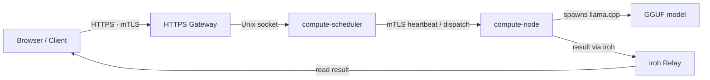

# Platform Node

> A crash-consistent, mutually-authenticated scheduler for text-inference jobs across a fleet of Linux x86_64 GPU workers — written in Rust.

[](LICENSE)
[](#project-status)

Platform Node schedules text-inference jobs across Linux x86_64 GPU workers. The scheduler keeps a queue and places jobs on workers that have a compatible model plan and free capacity. A compute node manages its local inference processes and reports GPU memory, loaded models, and active tasks.

| Program | Responsibilities |
| --- | --- |
| `compute-scheduler` | Node inventory, queue, dispatch, task status, and an optional HTTPS gateway |
| `compute-node` | Hardware diagnostics, model lifecycle, inference, and remote scheduler connectivity |

Workers authenticate to the scheduler with mutual TLS. The optional gateway uses its own TLS credentials. The result transport for the browser experience path uses iroh and a configured relay.

## Why read this code

This repository is a **reference implementation**: it was extracted from a larger internal platform and kept intentionally focused and self-contained. It solves a handful of problems that are easy to get wrong in distributed systems, in a small, auditable codebase.

- **Crash consistency without a database.** Tasks and nodes live in memory, yet the system survives restarts and crashes through a fencing scheme of `installation_id` + `generation` + `run_id` + `attempt_id`. A task whose execution cannot be confirmed is reported as `outcome_unknown` and is *never replayed*, while provably-retryable failures are retried with backoff.
- **Defensive filesystem and IPC hardening.** State files are forced to `0700` / `0600`; symlinks and hardlinks are rejected (`O_NOFOLLOW`, `nlink == 1`); Unix sockets verify peer credentials; a single instance is enforced with `flock`; every write is temp-file + rename + fsync.
- **Mutual TLS everywhere.** Worker↔scheduler uses TLS 1.3 with pinned client certificates, the gateway uses its own credentials, and the iroh result path signs endpoint registrations with Ed25519.
- **Resource planning with calibration.** Per-GPU VRAM estimates, multi-GPU tensor-split, and CPU-thread / host-memory budgets are calibrated against observed peaks, with a quarantine state for uncertain exits.

## Architecture



## Repository layout

```
apps/compute-scheduler/    Control plane: queue, dispatch, gateway, admission journal
apps/compute-node/         Data plane: model pool, lifecycle, resource planning, remote link
crates/platform-node-link/ Wire protocol: framing, mTLS, heartbeat/assignment/report messages
crates/hardware-probe/     Local hardware discovery (NVML, CPU, memory)
scripts/platform-node/     Packaging, model prep, smoke tests, systemd service units
```

Two files are a good place to start: `apps/compute-scheduler/src/queue.rs` (dispatch, retry, and the `outcome_unknown` model) and `apps/compute-node/src/resource_plan.rs` (VRAM estimation and calibration).

## Build and test

Use Linux x86_64 with Rust, a C compiler, Python 3, and OpenSSL.

```sh
cargo test --workspace --locked
cargo build --release --locked -p compute-scheduler -p compute-node
./target/release/compute-scheduler --help
./target/release/compute-node doctor --json
```

Inference requires a compatible llama.cpp runtime, a GGUF model, and a node model plan. Consult the [scheduler setup](scripts/platform-node/service-packages/scheduler/README.txt) and [node setup](scripts/platform-node/service-packages/node/README.txt) for configuration and service commands. The examples use a local test endpoint.

## Package and install

Build on the oldest distribution you intend to support, then create one archive per binary.

```sh
(cd target/release && sha256sum compute-scheduler > compute-scheduler.sha256)
(cd target/release && sha256sum compute-node > compute-node.sha256)
python3 scripts/platform-node/package-services.py \
  --scheduler-binary target/release/compute-scheduler \
  --node-binary target/release/compute-node \
  --output dist --date "$(date +%Y%m%d)"
```

On the destination host, check the archive with its SHA-256 file, unpack it, and run `bash install.sh` as the service user. The installer registers the program in `~/.local/bin` and adds that directory to Bash's PATH. Configure and start the services using the package README, then run:

```sh
compute-scheduler status
compute-node status
compute-node gpu list
```

## Project status

Early-stage. Run `compute-node doctor --json` to see the capability flags: several (node registration, platform tasks, multi-model scheduling, idle unload) are not yet implemented. There is no OpenAI-compatible API and no streaming yet. Treat this as a reference for the scheduling, consistency, and security patterns rather than a turnkey product.

## License

Licensed under the [MIT License](LICENSE).
